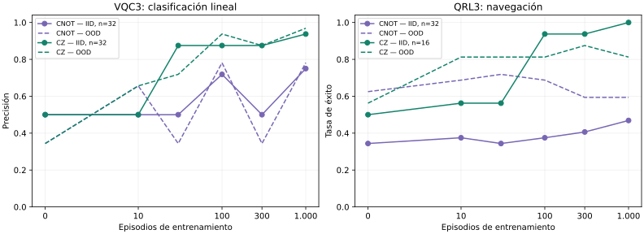

# Resultados: registros conectados de 1.000 cúbits

Se eliminó la separación fija en grupos de cuatro. Cada agente utiliza un componente de 1.000 sitios, 999 enlaces y entrenamiento de sus 1.000 ángulos. Los modelos anteriores permanecen intactos.

## Campañas reales

Todas ejecutaron 1.000 episodios desde parámetros nuevos, semilla 173, con checkpoints a 100 y 1.000. Una muestra etiquetada cuenta como episodio VQC; un episodio QRL contiene varias decisiones. Las cifras de esta tabla son **validación**, utilizada al seleccionar la arquitectura.

| Circuito | Agente / tarea | IID | OOD | Casos por conjunto | Entrenamiento nativo (s) | Mediana episodio (ms) | Bucle de actualización (ms) | RSS XI (MiB) |
|---|---|---:|---:|---:|---:|---:|---:|---:|
| CNOT | VQC / linear | 75.00% | 78.12% | 32 | 108.599 | 106.013 | 26.337 | 18.31 |
| CNOT | VQC / dense | 53.12% | 37.50% | 32 | 109.428 | 106.925 | 26.357 | 17.55 |
| CNOT | QRL / line_easy | 46.88% | 59.38% | 32 | 679.664 | 867.617 | 165.576 | 23.83 |
| CZ | VQC / linear | 93.75% | 96.88% | 32 | 110.432 | 107.947 | 26.514 | 18.15 |
| CZ | VQC / dense | 65.62% | 56.25% | 32 | 108.854 | 106.492 | 26.157 | 17.85 |
| CZ | QRL / line_easy | 100.00% | 81.25% | 16 | 435.762 | 371.301 | 84.194 | 23.68 |

La medición del episodio incluye circuito y cálculo de gradientes. La columna de actualización mide el bucle de cambios/eligibilidades; no incluye las observaciones X/Z calculadas en el forward. RSS corresponde al proceso XI, no a toda la máquina. Las tareas y las cantidades de decisiones difieren: estos tiempos no ordenan tecnologías ni prueban una ventaja cuántica.

La variante CNOT conserva la conectividad pero aprendió poco en QRL. CZ conserva el mismo registro de 1.000 y mejoró el aprendizaje en estas tareas. La tarea densa conserva resultados modestos; los 1.000 cúbits no garantizan generalización.

## Evaluación final con casos nuevos

Después de seleccionar CZ se utilizó la semilla nueva 20261103, 64 casos IID y 64 OOD, disjuntos del entrenamiento. No se ajustaron parámetros en esta evaluación. Los conjuntos IID/OOD de las curvas anteriores son de validación; no se presentan como esta prueba final.

| Agente / variante | Inicial IID | Entrenado IID | Entrenado OOD | Observaciones anuladas IID | Aleatorio IID |
|---|---:|---:|---:|---:|---:|
| VQC / CZ | 45.31% | 92.19% | 84.38% | 45.31% | — |
| QRL / CZ | 25.00% | 100.00% | 90.62% | 28.12% | 25.00% |
| QRL / CNOT | 25.00% | 56.25% | 70.31% | 56.25% | 25.00% |

Los JSON de evaluación contienen intervalos Wilson del 95%, recompensas y cantidad de decisiones. Una sola semilla de entrenamiento y 64 casos por conjunto no establecen un resultado general. Anular observaciones es un control para comprobar que las mediciones afectan la política y la clasificación.

## Entrega y verificaciones

- Modelo combinado: dos componentes de 1.000, con 1.000 episodios nuevos por agente. Los parámetros combinados conservan los hashes de los dos entrenamientos de origen.
- Los 999 cortes del estado de cada agente presentan entrelazamiento en la verificación. No se mide ni afirma entrelazamiento máximo.
- Las pruebas verifican derivadas del score, cambios reales en los 1.000 ángulos, etiquetas ocultas, rollback y reanudación idéntica. En CZ las observaciones locales dependen de vecinos; la prueba de influencia primer→último corresponde a la variante CNOT, disponible explícitamente.
- Los archivos anteriores se conservaron. La migración verifica el hash original y mantiene ángulos, pesos y sesgos en una copia; su rendimiento no se presume transferido.
- El runtime quedó integrado en [REVERSE-PC #172](https://github.com/guadalupejuan001-code/REVERSE-PC/pull/172). La CI cuántica, las regresiones nativas con sanitizadores y la compilación APK pasan. Persiste el fallo previo del saludo clásico de escritorio; la misma aserción falla en la base anterior, según [runtime-ci.json](runtime-ci.json).
- Estas campañas no repiten 10.000 episodios ni revalidan los módulos históricos de planificación/acoplamiento. Los resultados anteriores de grupos de cuatro no se atribuyen al circuito nuevo.

[Manifiesto del modelo](model.json) · [Hashes y checkpoints](CHECKPOINTS.json) · [Datos completos](data.json) · [Validación XI](validation.json) · [CSV](curves.csv)

Modelo principal: [BBYQ-VQC3-QRL3-1000x2-CONECTADOS-CZ.rvp.gz](../../../models/quantum1000/BBYQ-VQC3-QRL3-1000x2-CONECTADOS-CZ.rvp.gz). Descomprimir gzip antes de abrirlo con el runtime conectado.
