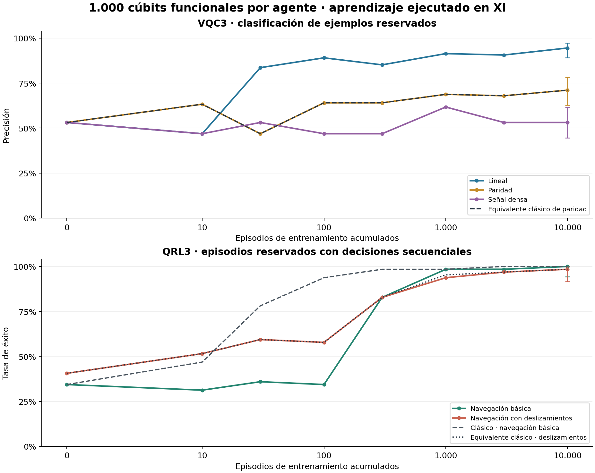
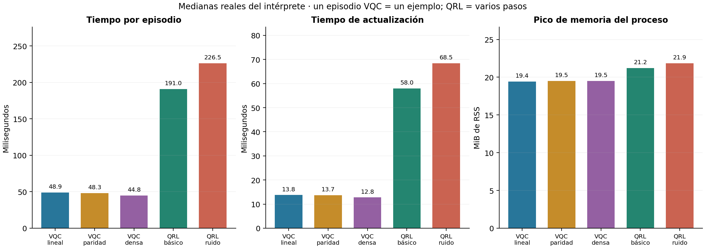
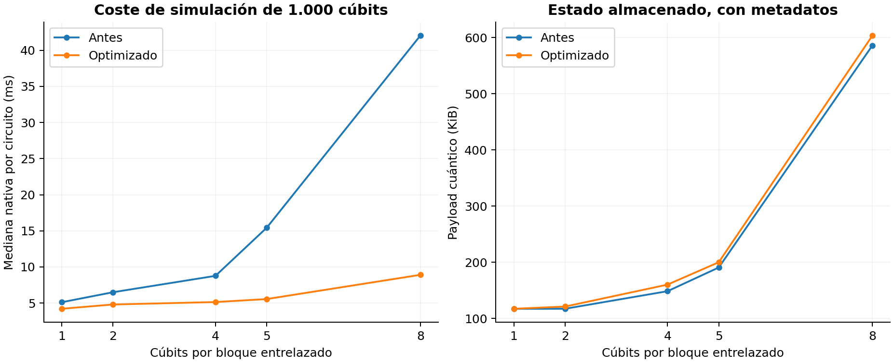
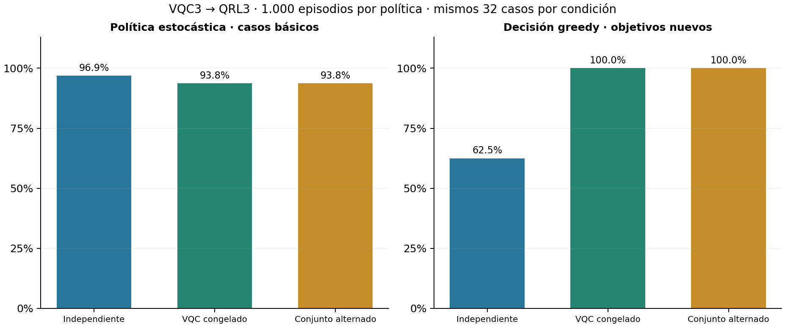

# VQC3 y QRL3: resultados verificables con 1.000 cúbits por agente

Se implementaron y ejecutaron dos agentes cuánticos simulados y entrenables
en XI. Cada forward utiliza 1.000 cúbits, con codificación, rotaciones continuas,
CNOT y observaciones que afectan la salida y los gradientes. Los 1.000 ángulos
y los 1.000 pesos por agente recibieron actualizaciones en las campañas largas.
El entrelazamiento se limita a 250 bloques de cuatro cúbits por agente.

Los resultados acreditan aprendizaje en estos problemas sintéticos; no una
capacidad de aprendizaje general ni una ventaja cuántica computacional.

## Campañas principales

La evaluación principal usa 128 ejemplos reservados por tarea VQC y 64 episodios por entorno QRL. Las campañas principales usan semilla 173.

| Agente y tarea | Episodios | Acierto/éxito reservado | OOD | Mediana ms/episodio | Mediana ms/actualización | Experiencias | Pico RSS MiB |
| --- | --- | --- | --- | --- | --- | --- | --- |
| VQC3 · Lineal | 10000 | 94.53 % | 96.88 % | 48.87 | 13.76 | 10000 | 19.43 |
| VQC3 · Paridad | 10000 | 71.09 % | 81.25 % | 48.27 | 13.73 | 10000 | 19.51 |
| VQC3 · Señal densa | 10000 | 53.12 % | 57.81 % | 44.75 | 12.78 | 10000 | 19.52 |
| QRL3 · Navegación básica | 10000 | 100.00 % | 82.81 % | 191.04 | 57.98 | 33074 | 21.22 |
| QRL3 · Navegación con deslizamientos | 10000 | 98.44 % | 93.75 % | 226.48 | 68.47 | 46131 | 21.86 |

Un episodio VQC es un ejemplo etiquetado. Un episodio QRL incluye varios
estados, acciones y transiciones. Las tasas de ambas columnas corresponden a
tareas diferentes y no constituyen una competición de inteligencia.

Los tiempos nativos se miden dentro de XI. Las actualizaciones incluyen el
cálculo de gradientes y el cambio de parámetros, no un solo parámetro aislado.
El CSV conserva además la suma de tiempos con transporte y generación de
datos. El RSS es del proceso nativo, con los dos registros configurados;
excluye Python y las herramientas de análisis. Se ejecutaron varias campañas
concurrentes en un entorno con cuota de ocho vCPU. No son medidas del teléfono.

Se guardaron y evaluaron los estados de 100, 1.000 y 10.000 episodios, además
de puntos intermedios. Son prefijos acumulativos del mismo entrenamiento, no
tres réplicas independientes. Los intervalos Wilson del 95 % describen la
incertidumbre del conjunto reservado, no la variación entre entrenamientos.

## Qué tan pronto se observó mejora

Se usa un criterio descriptivo: +10 puntos porcentuales para VQC y +20 para
QRL sobre su propia evaluación inicial, manteniéndose por encima en los
controles posteriores. Solo se conoce el primer control que lo cumple, no el
episodio exacto de inicio ni una complejidad de muestras universal.

| Campaña | Umbral descriptivo | Primer control sostenido | Experiencias acumuladas |
| --- | --- | --- | --- |
| vqc-linear-s173 | 63.12% | 30 | 30 |
| vqc-parity-s173 | 63.12% | 100 | 100 |
| vqc-dense-s173-replay | 63.12% | No alcanzado de forma sostenida | — |
| qrl-easy-s173 | 54.37% | 300 | 1716 |
| qrl-slip-s173-v2 | 60.62% | 300 | 2344 |

## Cobertura funcional y coste

Cada forward de un agente independiente ejecuta 2.000 RY, 750 CNOT y 1.000
observaciones. El gradiente de cuatro ángulos requiere ocho circuitos locales
adicionales: 64 RY, 24 CNOT y 32 observaciones. Los 1.000 pesos de lectura se
actualizan por ejemplo o mediante las elegibilidades del episodio. Los ángulos
se recorren cíclicamente; cuatro gradientes por decisión no significa cuatro
cúbits activos. Los contadores de cambios no nulos están en cada manifiesto.

Se validaron 2.000 derivadas causales no nulas en los dos registros simultáneos.
Las mediciones son expectativas de Born analíticas en un simulador clásico,
sin disparos físicos. La anchura del bloque es una elección de topología, no
un límite global de cuatro cúbits. El coste de almacenamiento local crece
con suma de 2^b sobre los bloques; no se materializa un statevector de 2^1000.

## Límites observados

- La señal densa contiene 1.000 entradas pseudoaleatorias por ejemplo. VQC3
  obtuvo un resultado cercano al azar; no se acreditó aprendizaje útil de esa
  tarea frente al baseline clásico de cosenos.
- Los primeros problemas y la navegación usan cuatro canales latentes
  repetidos sobre los 1.000 cables. Anchura funcional no equivale a 1.000
  variables independientes ni a entrelazamiento global.
- En navegación, la calidad depende de la semilla. Las réplicas de 1.000
  episodios y la caída OOD tras más entrenamiento se conservan; más episodios
  no garantizan mejor generalización.
- OOD significa ruido de entrada mayor o posiciones/objetivos reservados.
  La transferencia a otra regla de clasificación se mide por separado y no
  acredita una capacidad de resolver cualquier problema nuevo.

## Integración y planificación

Se comparó QRL independiente con VQC preentrenado y congelado y con entrenamiento
conjunto alternado. Los datos pareados usan los mismos 32 casos por condición.
Los modos conectados requieren además el preentrenamiento VQC y dos circuitos
de 1.000 cúbits por decisión. El entrenamiento conjunto aprende una tarea
auxiliar a partir del éxito observado; no es backpropagation end-to-end.

El planificador XI hace dos rollouts por acción y horizonte tres, usando la
política aprendida para continuar y reglas de transición/recompensa conocidas.
Se probó también sin entrenamiento. Su capacidad proviene de búsqueda más
política; no se afirma que haya aprendido por sí solo el modelo del mundo.

## Comparación clásica y controles

El baseline de cosenos tiene el mismo número de parámetros y el mismo
optimizador. También se implementó un equivalente clásico analítico exacto de
este mapa cuántico particular. Coincidió con 8.000 observaciones con diferencia
máxima de 5,83e-16 y, tras diez ejemplos, con los parámetros hasta 2,23e-16.
Las curvas equivalentes se solapan. No se demuestra ventaja computacional
cuántica; una diferencia frente al baseline de cosenos puede provenir del
mapa de características y de su sesgo inductivo.

La inferencia conserva su resultado al permutar una etiqueta oculta. La
reanudación VQC conserva idénticos parámetros. Se evalúan políticas aleatorias,
modelos sin entrenamiento y observaciones anuladas. Los datos reservados usan
semillas distintas, comprobadas contra todas las semillas de entrenamiento.
Las reglas del entorno son explícitas; el agente no consulta la etiqueta en
inferencia ni una respuesta correcta de acción durante el aprendizaje.

## Conservación, código y CI

Se conserva el checkpoint anterior de 800/800 episodios y se comprueba su
SHA-256 antes y después. Los nuevos agentes usan memoria y rangos cuánticos
separados. Al combinarlos, coexisten 2.000 cúbits antiguos y 2.000 nuevos.
Las transferencias de parámetros se verifican byte a byte mediante los hashes
de los modelos y nunca reemplazan un archivo de entrada.

- [PR BBY-Q #67](https://github.com/guadalupejuan001-code/BBY-Q/pull/67)
- [PR REVERSE-PC #171](https://github.com/guadalupejuan001-code/REVERSE-PC/pull/171)
- [CI de entrenamiento e integración](https://github.com/guadalupejuan001-code/BBY-Q/actions/runs/41390512045)
- [CI de primitivas cuánticas](https://github.com/guadalupejuan001-code/REVERSE-PC/actions/runs/41388046247)

La prueba Android del saludo clásico de BBY Q falla también en la base original
con el mismo error; queda documentada y no se modifica ningún motor conversacional.
Las pruebas cuánticas, de integración y del sistema se informan por separado.

## Datos y reproducción

`curves.csv` y `data.json` contienen las curvas y condiciones, con hashes de
checkpoints, ejecutor y fuentes XI. Los manifiestos originales conservan sus
medidas; en los informes normalizados, hardware físico es falso y simulación
clásica es verdadero para los agentes cuánticos. Las fuentes, construcción y
comandos de uso están en el repositorio. Los modelos entrenados y sus prefijos
se entregan en el paquete de checkpoints con su índice SHA-256.

## Comparación final con los controles clásicos

| Campaña | Episodios | IID | OOD | Mediana nativa ms/episodio | Cúbits efectivamente usados |
| --- | --- | --- | --- | --- | --- |
| vqc-parity-s173 | 10000 | 71.09 % | 81.25 % | 48.27 | 1000 |
| classical-parity-s173 | 10000 | 46.88 % | 56.25 % | 30.19 | 0 |
| analytic-parity-s173 | 10000 | 71.09 % | 81.25 % | 33.27 | 0 |
| vqc-dense-s173-replay | 10000 | 53.12 % | 57.81 % | 44.75 | 1000 |
| classical-dense-s173-replay | 10000 | 72.66 % | 73.44 % | 29.05 | 0 |
| qrl-easy-s173 | 10000 | 100.00 % | 82.81 % | 191.04 | 1000 |
| classical-qrl-easy-s173 | 10000 | 100.00 % | 73.44 % | 142.30 | 0 |
| qrl-slip-s173-v2 | 10000 | 98.44 % | 93.75 % | 226.48 | 1000 |
| analytic-qrl-slip-s173 | 10000 | 98.44 % | 93.75 % | 183.76 | 0 |

Los baselines conservan el registro configurado del fixture común, pero ejecutan cero operaciones cuánticas. La columna anterior cuenta utilización funcional, no solo registros reservados. El equivalente analítico coincide con la capacidad del circuito y puede ejecutarse con coste menor; no hay ventaja cuántica demostrada.

## Variación entre semillas a 1.000 episodios

| Campaña | IID | OOD | Casos por evaluación | Experiencias |
| --- | --- | --- | --- | --- |
| vqc-parity-s173 | 68.75 % | 81.25 % | 128 | 1000 |
| vqc-parity-s397 | 68.75 % | 75.00 % | 64 | 1000 |
| vqc-parity-s911 | 78.12 % | 82.81 % | 64 | 1000 |
| qrl-easy-s173 | 98.44 % | 93.75 % | 64 | 4362 |
| qrl-easy-s397 | 40.62 % | 56.25 % | 32 | 5625 |
| qrl-easy-s911 | 56.25 % | 68.75 % | 32 | 5606 |

Las réplicas cambian tanto la semilla de entrenamiento como la del conjunto reservado. No se usa su promedio como una precisión universal. En las semillas QRL 397 y 911, la probabilidad de ir a la derecha desde posición 3 se mantuvo cerca del 1–2 % incluso con objetivo 6. La política quedó polarizada a la izquierda; la estabilidad es una limitación real. Los seis valores medidos están en `verification/seed-policy-probes.json`.

## Transferencia a reglas y dificultad nuevas

| Modelo de origen | Tarea evaluada sin actualizar | Resultado | Casos |
| --- | --- | --- | --- |
| VQC lineal, 10.000 ejemplos | linear | 94.53 % | 128 |
| VQC lineal, 10.000 ejemplos | parity | 42.97 % | 128 |
| VQC lineal, 10.000 ejemplos | radial | 46.09 % | 128 |
| VQC lineal, 10.000 ejemplos | dense | 53.12 % | 128 |
| QRL básico, 1.000 episodios | line_easy | 93.75 % | 64 |
| QRL básico, 1.000 episodios | line_slip | 89.06 % | 64 |

El modelo lineal no transfirió su regla a paridad o radio. La política básica de 1.000 episodios sí conservó parte de su éxito al introducir deslizamientos, dentro del mismo mundo de siete posiciones. Esto no demuestra transferencia universal.

## Integración: resultados pareados

| Modo | Estocástica IID | Estocástica OOD | Greedy IID | Greedy OOD |
| --- | --- | --- | --- | --- |
| independent | 96.88 % | 96.88 % | 100.00 % | 62.50 % |
| frozen | 93.75 % | 100.00 % | 100.00 % | 100.00 % |
| joint | 93.75 % | 100.00 % | 100.00 % | 100.00 % |

La representación congelada mejoró el comportamiento greedy en estos 32 casos OOD: 20/32 a 32/32. Con acciones estocásticas la diferencia es pequeña y los intervalos se solapan. El entrenamiento conjunto alternado no añadió una mejora frente al congelado. Ambas conexiones pagan el preentrenamiento VQC de 1.000 ejemplos y otro circuito de 1.000 cúbits por decisión. Solo se estudió una semilla de entrenamiento en esta comparación; no se establece una mejora general.

## Planificación con reglas conocidas

| Modelo | Éxito OOD, n=32 | Recompensa media | Mediana ms/episodio |
| --- | --- | --- | --- |
| checkpoint-00000.rvp | 93.75 % | 0.8800 | 543.59 |
| checkpoint-01000.rvp | 100.00 % | 0.9506 | 484.17 |

La búsqueda ya resuelve muchos casos con la política sin entrenar. La diferencia entre 30/32 y 32/32 no separa con claridad el efecto del aprendizaje; los intervalos se solapan. Los parámetros permanecieron intactos durante la planificación.

## Optimización del transporte y persistencia

| Condición | CLI ms/actualización | Sesión ms/actualización | Cociente observado | Checkpoint final |
| --- | --- | --- | --- | --- |
| Con campañas concurrentes | 164.08 | 76.37 | 2.15× | Idéntico byte a byte |
| Sin campañas de entrenamiento | 164.27 | 66.99 | 2.45× | Idéntico byte a byte |

Cada comparación ejecutó exactamente la misma secuencia XI de 30 actualizaciones desde el mismo checkpoint. La sesión evita iniciar un proceso y reserializar todo RVPC2 después de cada paso. Es una mejora del transporte y del intérprete, sin alterar el aprendizaje ni demostrar ventaja cuántica. El perfil de bloques usa 30 mediciones tras dos calentamientos, sin campañas de entrenamiento simultáneas. El coste del estado puede aumentar levemente al preservar factores y evitar refactorizaciones; no se oculta ese intercambio.

## Integridad de los diarios y conservación de resultados

| Campaña inicial | Filas iniciales conservadas | Filas de la repetición | Verificación |
| --- | --- | --- | --- |
| classical-dense-s173 | 97 | 10000 | Parámetros y contadores idénticos |
| vqc-dense-s173 | 293 | 10000 | Parámetros y contadores idénticos |

Los checkpoints y resúmenes originales estaban completos, pero dos diarios por episodio eran parciales. Se conservaron esos archivos y se repitieron las dos campañas en directorios nuevos. Las curvas y tiempos detallados de señal densa usan las repeticiones completas; no se estimaron tiempos ausentes. La publicación del diario es ahora atómica en cada checkpoint y el ejecutor de campañas exige el conteo completo antes de terminar. `journal-recovery.json` documenta la reparación.

## Checkpoint principal entregado

El archivo `BBYQ-VQC3-QRL3-1000x2-ENTRENADOS.rvp` combina VQC3 lineal y QRL3 con deslizamientos, ambos con 10.000 episodios. Conserva los modelos anteriores de 800/800. Hay 4.000 cúbits registrados: 2.000 antiguos y 2.000 nuevos; cada operación de un agente V3 utiliza sus 1.000, como muestra `verification/merged-action.json`.

SHA-256: `eaba877ad9921e55fb4c191bea31dd2eb85ff3c72ba5261c3568709757926e76`.

El paquete de checkpoints conserva los prefijos, condiciones originales, diarios, variantes y hashes. El modelo principal es experimental y específico de sus tareas. La integración expuesta es nativa mediante XI/REVERSE-PC y comandos, con código compilado y probado; no se entrega una nueva interfaz Android ni una APK en esta misión.
